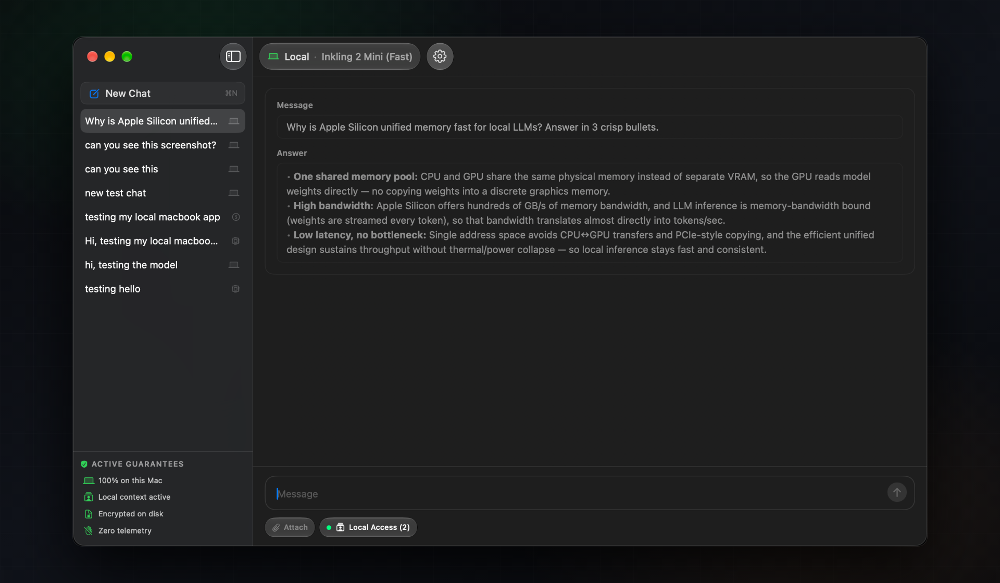

<p>
  
</p>

# Cloak

Cloak is a macOS menu bar app for private AI — local on Apple Silicon, or routed to remote models with explicit, inspectable privacy boundaries.

[Watch the 60s walkthrough](https://regents.sh/images/cloak/demos/cloak-walkthrough-60s.mp4) 📽️ · [Website](https://regents.sh/cloak) · [Docs](https://regents.sh/docs/cloak/reference) · [Releases](https://github.com/regents-ai/cloak-releases/releases)



> **Status (`v0.2.0 Beta`):** Signed, notarized `.dmg` builds are published at [regents-ai/cloak-releases](https://github.com/regents-ai/cloak-releases/releases). Cloak is **beta software** and its privacy protections have not yet undergone an independent security audit — keep wallet balances small, back up or withdraw funds before wiping your Mac, and read the [Wallet Security, Recovery & 30-Day zkAPI Limit](docs/wallet-security.md) guide ([web copy](https://regents.sh/docs/cloak/wallets)).

## Install

Download `Regents-Cloak.dmg` from [Releases](https://github.com/regents-ai/cloak-releases/releases), drag **Cloak** into `/Applications`, and open it.

Verify any download independently using macOS's built-in Terminal tools and compare against `SHA256SUMS.txt` on GitHub Releases, [regents.sh/cloak/install#verify](https://regents.sh/cloak/install#verify), and **Settings → Status** inside the app:

```sh
shasum -a 256 ~/Downloads/Regents-Cloak.dmg
codesign -dvv --strict "/Applications/Cloak.app"
spctl --assess --type execute -vv "/Applications/Cloak.app"
```

Requires Apple Silicon and macOS 26 or later (macOS 27+ for optional Darkbloom inference serving).

## How it works

Cloak lives in your menu bar and starts paused. **Local** (`⌘1`) and **NEAR AI Gateway** (`⌘2`, with Tor off) work immediately without starting the VM.

When you press **Start** (`⌘S`), Cloak launches bundled Tor (`0.4.9.16`), a sandboxed local prompt rewriter (`Qwen 3.5 9B`), and an ephemeral, NIC-less Linux arm64 microVM (`Virtualization.framework`). Outbound traffic from the VM can only exit through Tor over `vsock:9050`. Models load on demand and unload automatically when idle so they do not hold unified memory when not in use.

You can chat directly in Cloak, toggle the built-in sandboxed **Pi** coding agent (`hammer` icon), or connect external coding tools and scripts to Cloak's local OpenAI-compatible gateway at `http://127.0.0.1:8742/v1`.

## Modes

Each conversation locks its mode on turn 1. The **Active Guarantees** rail in the bottom-left of Chat shows only the protections actually active for that thread.

| Mode | Where inference runs | What leaves your Mac | Payment / auth | What can still link requests |
| --- | --- | --- | --- | --- |
| **1. Local** (`⌘1`) | On your Mac (`vmlx-swift` MLX or Metal `llama.cpp`) | Nothing during chat once weights are downloaded | Free · no account | Nothing leaves your Mac |
| **2. NEAR AI Gateway** (`⌘2`) | [NEAR AI Cloud](https://cloud.near.ai) (`Qwen3.8-27B`, Intel TDX + NVIDIA enclaves) | Prompt as written, E2EE v2 encrypted to the verified enclave (optional Tor) | Your NEAR AI Cloud API key | Your NEAR API key identifies your NEAR account |
| **3. Token Inference** (`⌘3`) | [Venice AI](https://venice.ai) or [Boundless](https://boundless.network) + Tempo | Locally rephrased user text over per-conversation Tor circuits | Local Base `USDC` (`x402`) / Venice key, or Tempo `USDC.e` (`MPP`) | A reused wallet address, channel, or API key can link chats |
| **4. zkAPI Anon Inference** (`⌘4`) | [Open Anonymity](https://zkapi.openanonymity.ai) (`zkAPI`) over Tor | Locally rephrased user text over per-conversation Tor circuits | Fresh one-time ZK spend credential per turn (from an ETH deposit) | Prompt content, thread history, and timing can still correlate requests |
| **5. Darkbloom Serving** | On your Mac via [Darkbloom](https://darkbloom.dev) ([EigenLayer](https://eigenlayer.xyz)) | Local Only stays on your Mac; Network + Local serves idle compute to Darkbloom | Earn payouts on idle Apple Silicon (`0%` platform cut, macOS 27+) | Linked `console.darkbloom.dev` provider account (Network + Local only) |


## Features

- **Fast local Apple Silicon inference** — pure-Swift MLX (`Inkling 2 Mini`, 10.21 GB, ~56–64 tok/s on M4 Max, fits 16 GB+ Macs) plus Metal `llama.cpp` GGUF tiers and an optional 44 MB uncensored LoRA
- **Zero telemetry** — no analytics, no crash reports, no Regents account, and Sparkle system profiling disabled
- **Hardware-attested enclaves** — native Rust verifier (`cloak-near`) checks Intel TDX quotes (`dcap-qvl`), pinned `app_compose` measurements, and Intel Trust Authority NVIDIA GPU verdicts before E2EE v2 encryption
- **Local prompt rephrasing** — sandboxed `Qwen 3.5 9B` strips writing style and filler before cloud turns, keeping code, paths, URLs, and identifiers intact, and fails closed on error
- **Per-conversation Tor + instant Cover Traffic** — isolated SOCKS5 circuits per thread, plus host-side Cover Traffic that toggles live with zero restart and logs every fetch locally
- **Accountless crypto rails** — separate local Keychain wallets per rail (Venice Base `USDC`, Boundless Tempo `USDC.e`, and zkAPI Ethereum Mainnet `ETH`), all inspectable together under **Settings → Wallets**
- **Sandboxed Pi coding agent** — runs shell and file tools inside the throwaway NIC-less Linux VM over `torsocks` without touching macOS files
- **Native macOS shell** — ChaCha20-Poly1305 encrypted chats, pure-Swift Markdown + LaTeX math, Liquid Glass menu bar panel, global Quick Prompt hotkey, Control Center & Desktop widgets, and a bundled `cloak` CLI

## Example requests

Generate a per-app bearer key (`cloak-<64 hex>`) in **Settings → Connected Apps**, then point Cursor, Cline, Continue, Aider, or any OpenAI SDK at `http://127.0.0.1:8742/v1` (rephrases `role == "user"` text locally and pays via **zkAPI Anon Inference** over Tor):

List available models:

```sh
curl http://127.0.0.1:8742/v1/models \
  -H "Authorization: Bearer <cloak-app-key>"
```

Send a chat completion:

```sh
curl http://127.0.0.1:8742/v1/chat/completions \
  -H "Authorization: Bearer <cloak-app-key>" \
  -H "Content-Type: application/json" \
  -d '{
    "model": "anthropic/claude-sonnet-5.5",
    "messages": [{"role": "user", "content": "Review PR #418 for edge cases."}]
  }'
```

## Local Access & Offline Data

Everything in **Settings → Local Access** is off by default and wired **exclusively into Local Mode** (cloud modes, Connected Apps, and the Pi agent have zero code path to it):

- **Per-message file attachments** — click **Attach** or drag & drop PDFs (with automatic Vision OCR for scanned PDFs), screenshots/images (on-device Apple Vision OCR), `.docx`/`.rtf`/`.odt` documents, Markdown, and code files
- **Hermes-compatible memory & approved folders** — owner-only `USER.md`/`MEMORY.md` (optional `~/.hermes/memories/` sync) and read-only keyword search over approved folders (skipping dotfiles, `.env*`, and private keys)
- **Opt-in macOS connectors** — read-only basic Mac info, Calendar (next 7 days), Reminders, and query-matched Contacts
- **Progressive Offline Data** — **Settings → Offline Data** downloads resumable Minimum → Maximum packs for Kiwix Library (`174 MB → 61 GB`), DevDocs (`15 MB → 240 MB`, 1-click linkable into Local Mode), CourtListener (`540 KB → 58.3 GB`), PubMed Central S3 CLI, and [Tinfoil Kit](https://github.com/tudor-city-ventures/tinfoil-kit)

## Inference Serving (Darkbloom)

On macOS 27+, **Settings → Inference Serving** integrates [Darkbloom](https://darkbloom.dev) ([Eigen Labs](https://github.com/Layr-Labs/d-inference)) with a unified 3-way **Serving Mode** (`Off` / `Local Only` / `Network + Local`):

- Verifies Darkbloom's signed binary (`Team SLDQ2GJ6TL`) before talking to its loopback-only control API
- Ranks Apple Silicon models that fit beside Cloak by live payout rate, syncs live with the `darkbloom` CLI, and pauses network serving automatically when you actively use your Mac

## Demos

- **[60-second full walkthrough](https://regents.sh/images/cloak/demos/cloak-walkthrough-60s.mp4)** — all five modes, Local Access, Wallets, and Darkbloom serving
- **[Local Mode · Inkling 2 Mini (Fast)](https://regents.sh/images/cloak/demos/demo-local-inkling.mp4)** — offline Apple Silicon MLX streaming & attachments
- **[NEAR AI Gateway + Trace Commons](https://regents.sh/images/cloak/demos/demo-near-traces.mp4)** — hardware TEE verification, E2EE v2, and local trace export
- **[Token Inference · Venice AI (Base USDC)](https://regents.sh/images/cloak/demos/demo-venice.mp4)** — Tor-routed Venice Private/TEE models & Base USDC `x402`
- **[Token Inference · Boundless + Tempo](https://regents.sh/images/cloak/demos/demo-boundless-tempo.mp4)** — Tempo `USDC.e` MPP payment channels & mid-chat switching
- **[zkAPI Anon Inference](https://regents.sh/images/cloak/demos/demo-zkapi.mp4)** — Ethereum Mainnet wallet, one-time ZK spend credentials, and deposit tiers
- **[Darkbloom Inference Serving](https://regents.sh/images/cloak/demos/demo-darkbloom.mp4)** — `Off` / `Local Only` / `Network + Local` serving & live monitor telemetry

## Build from source

Requires Apple Silicon, macOS 26+, Xcode / Swift 6.2+, Rust, `uv`, and Docker (for the Linux arm64 guest image):

```sh
uv run scripts/fetch_sources.py
llama-worker/install.sh
guest/build.sh
host/build.sh
app/build.sh
swift test --package-path app
```

## Docs & Feedback

- **Wallet security & recovery (30-day zkAPI limit):** [docs/wallet-security.md](docs/wallet-security.md) · [regents.sh/docs/cloak/wallets](https://regents.sh/docs/cloak/wallets)
- **Architecture & codebase map:** [docs/tech-stack.md](docs/tech-stack.md) · **Runbook:** [docs/dev-runbook.md](docs/dev-runbook.md) · **Licenses:** [THIRD_PARTY_NOTICES.md](THIRD_PARTY_NOTICES.md)
- **Website & reference docs:** [regents.sh/cloak](https://regents.sh/cloak) · [regents.sh/docs/cloak/reference](https://regents.sh/docs/cloak/reference)
- **Issues & feedback:** [GitHub Issues](https://github.com/regents-ai/cloak/issues) · [Patchbay](https://regents.sh/patchbay/cloak) · [@regents_sh](https://x.com/regents_sh) · [build@regents.sh](mailto:build@regents.sh)
